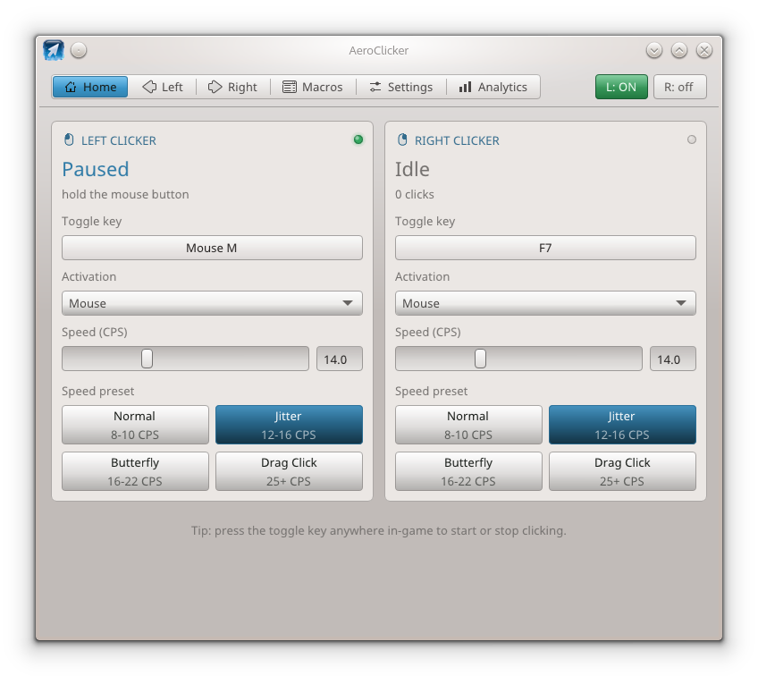
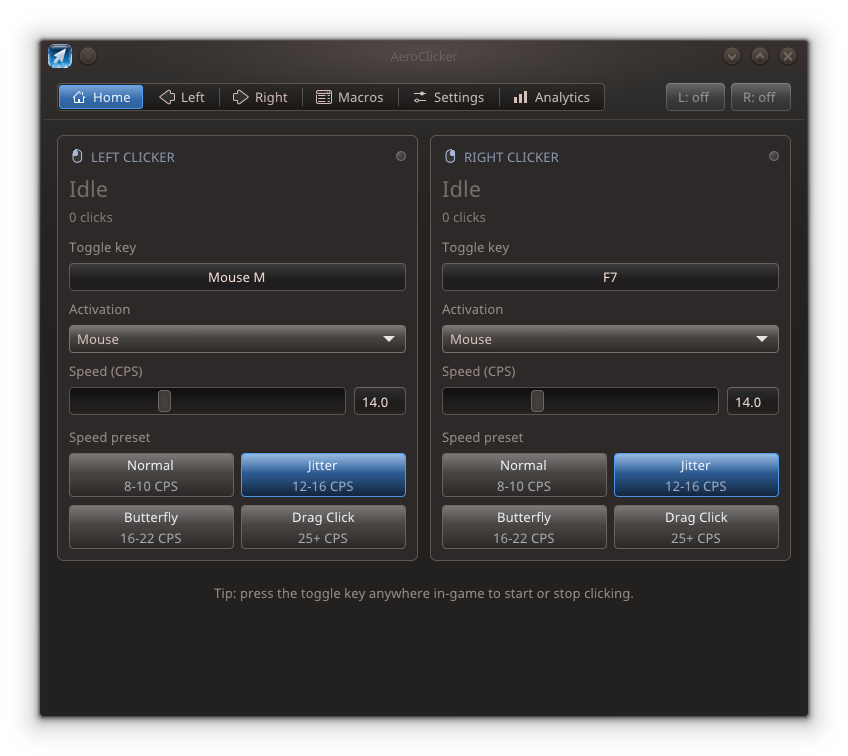

<p align="center">
  
</p>

<h1 align="center">AeroClicker</h1>

<p align="center">
  A humanized auto-clicker for Linux with a custom Oxygen/KDE-inspired interface.
</p>

<p align="center">
  
  
</p>

---

AeroClicker is a standalone auto-clicker for Wayland and X11. It injects clicks through
`/dev/uinput` and reads your keyboard and mouse through evdev, so it works with any application
and never touches the applications themselves.

The interface is custom: it borrows the Oxygen/KDE look — gradients, 1 px borders, hover states
and themed graphs — and follows your KDE colour scheme, light or dark.

AeroClicker is a fork of [Aubergine-UX's Ghast Clicker](https://github.com/Aubergine-UX/Ghast-Clicker),
which in turn ports the humanization engine from [IcySnex/GhostTap](https://github.com/IcySnex/GhostTap).
See [Credits](#credits).

---

## Contents

[Features](#features) · [Requirements](#requirements) · [Install](#install) ·
[Usage](#usage) · [Minecraft mod](#minecraft-mod) · [Interface](#interface) ·
[Files](#files) · [Troubleshooting](#troubleshooting) · [Credits](#credits)

---

## Features

**Clicking**
- **Two independent clickers** — separate left/right CPS, humanization, activation mode and keybind
- **Humanization** — Gaussian and uniform timing, spikes and stutters, heavy holds, grip drift, rhythm volatility and tension, a start delay in Mouse mode, and fatigue breaks
- **Presets** — Normal, Jitter (the default), Butterfly and Drag Click, ready to tweak
- **Double-clicks** — optional, with a randomized delay; they land inside the current beat, so they never lower the average CPS

**Control**
- **Activation modes** — Toggle, Hold, and Mouse (arm with a key, then hold your real mouse button)
- **Slot activation** — optional and off by default: a Minecraft hotbar slot switches each clicker on and off, with a per-clicker set of slots (default: slot 1 left, slot 9 right); turn on **Follow hotbar slots** on the Mod tab to use it (the slot boxes grey out while it is off, keeping their stored mapping). It reads the game through the [bridge mod](#minecraft-mod)
- **Menu pause** — clicking stops while the game has a screen open (inventory, chat, chests, NPC menus) and resumes when it closes
- **Left gate** — the **Left clicker** card on the Mod tab: the left clicker can require a mob, player or fireball in the crosshair, a sword in hand, or both, so it does not fire while you mine or build; the default is target-in-crosshair, and the target check reaches about half a block past vanilla reach so an incoming player or fireball becomes a target just before it can hit you
- **Right gate** — the **Right clicker** card on the Mod tab: the right clicker can require a placeable block in hand, so right-click actions never fire on a sword, a pearl or an empty hand; **Placeable blocks only** and **Only while looking at a block** are on by default, and **Skip beds** is on by default and greys out while the block gate is off
- **Jump reset / Sprint reset** — optional and off by default: both fire from the bridge mod's game events, not from the app's own clicks. Jump reset presses Space when an entity hurts the player (fall, fire and other environmental damage are ignored); sprint reset breaks sprint after a hit on a living entity, with randomized chance, delay and W-/S-/Shift-tap duration. Jump reset stays quiet when the damage came from behind. Each reset has its own toggle key, and binding both to one key toggles both together, exactly like the two clickers
- **Macros** — optional, off by default: sequences of left clicks, right clicks, delays and slot switches, with looping and a keybind
- **Headless mode** — run the clicker with no window

**Interface**
- **Paused readout** — a switched-on clicker that is held back shows `Paused` and the reason, with an amber dot, instead of a misleading green `ON`
- **Live analytics** — real-time CPS graphs, session averages and peaks, how often each combat reset fired, optional recording and CSV export; **Clear Data** resets the graphs, session stats and reset counts together
- **Profiles** — save and load complete configurations; the `config` profile loads at startup
- **Theming** — follows the KDE colour scheme and accent; the accent can also be fixed to Blue, Red, Green, Purple or Orange, or a custom colour
- **Sound feedback** — a short two-note chime when a module toggles, at most once per key press even if that key toggles several of them, via `paplay`

### Humanization defaults

The Jitter preset is tuned to look human without giving up rate. Double-clicks are rare — 1 % of
beats — and always land inside the current one, so they add clicks instead of lengthening the gap.
Fatigue breaks are short and infrequent: 0.25–0.6 s of rest every 30–75 s, and the break clock
restarts whenever clicking is paused, so resuming never begins with a break. Hold times follow the
rate and drift slowly around their mean, as a real hand's grip does, rather than being independent
random draws. Every value is editable on the **Left**/**Right** tabs, and **Normal**, **Butterfly**
and **Drag Click** raise the double-click chance as the click rate rises.

---

## Requirements

- Linux with write access to `/dev/uinput` and read access to `/dev/input/*` — see [Install](#install)
- C++17 compiler, CMake 3.16+
- GLFW 3 and OpenGL 3
- Optional: `paplay` (PipeWire/PulseAudio) for toggle sounds

Dear ImGui 1.93.0 is vendored in `imgui-1.93.0/`, so no extra downloads are needed.

---

## Install

### Dependencies

```bash
# Arch
sudo pacman -S --needed base-devel cmake glfw

# Debian / Ubuntu
sudo apt install build-essential cmake libglfw3-dev libgl1-mesa-dev

# Fedora
sudo dnf install gcc-c++ cmake glfw-devel mesa-libGL-devel

# Void Linux
sudo xbps-install -S base-devel cmake glfw-devel MesaLib-devel
# optional, for toggle sounds: sudo xbps-install -S pulseaudio-utils   (paplay)
```

### Build and install

```bash
cmake -S . -B build -DCMAKE_BUILD_TYPE=Release
cmake --build build -j"$(nproc)"
cmake --install build --prefix "$HOME/.local"   # per user, or without --prefix for /usr/local
```

The binary is also left at `build/aeroclicker` if you would rather not install it.

`cmake --install` writes three things under the prefix and touches nothing else:

| Path under the prefix | What it is |
| --- | --- |
| `bin/aeroclicker` | the binary |
| `share/applications/aeroclicker.desktop` | menu entry with the absolute binary path and the icon name |
| `share/icons/hicolor/*/apps/aeroclicker.png` | the app icon, one file per theme size |

Your settings are not part of the install: they live in `~/.config/aeroclicker/` and are created
on the first save. The udev rule below is not installed either — copy it yourself if you need it.
`build/install_manifest.txt` lists what was written, so `xargs rm -v < build/install_manifest.txt`
removes an install again.

### Permissions

AeroClicker needs write access to `/dev/uinput` and read access to your input devices. The
`input` group is the supported way to get both:

```bash
sudo usermod -aG input "$USER"
```

Log out and back in (a new terminal is not enough; the group list is read at login), then run
`aeroclicker` normally. If access is still missing, startup stops with `Cannot open /dev/uinput`
and the command to fix it.

**Do not run it as root.** `sudo` is not needed for anything the app does, and it gives a program
that synthesizes input full system privileges, a root-owned window in your session, and root's
environment instead of yours. The app tolerates `sudo`, but fix the group membership instead.

### Fix virtual-mouse sensitivity

Some desktops apply a different pointer acceleration curve to the virtual mouse. The included
udev rule gives it the same flat profile as a normal mouse:

```bash
sudo cp 99-aeroclicker.rules /etc/udev/rules.d/
sudo udevadm control --reload-rules
```

Reconnect the device (or restart AeroClicker) for the rule to apply.

---

## Usage

```bash
aeroclicker [options]
```

| Option | Description |
| --- | --- |
| `--lcps <n>` | Left CPS mean (default `13.0`) |
| `--rcps <n>` | Right CPS mean (default `15.0`) |
| `--lkey <code>` | Left hotkey as an evdev code (default `F6`) |
| `--rkey <code>` | Right hotkey (default `F7`) |
| `--toggle` | Toggle activation for both clickers |
| `--hold` | Hold activation for both clickers |
| `--mouse` | Mouse activation for both clickers (default) |
| `--headless` | Run without the GUI |
| `--save` | Save the configuration and exit |
| `-h`, `--help` | Show help |

Options apply on top of the saved `config` profile, for that run only. Key codes are evdev codes
(see `/usr/include/linux/input-event-codes.h`), not X11 keysyms; the GUI can also record keys
and mouse buttons interactively.

### Activation modes

| Mode | Behaviour |
| --- | --- |
| **Toggle** | Press the key to start, press again to stop |
| **Hold** | Clicks while the key is held |
| **Mouse** | Press the key to arm, then hold your real mouse button to auto-click; the real press is masked instead of reaching the application |

In Mouse mode AeroClicker takes exclusive access to the physical mouse so it can forward each
event exactly once. Other modes only read input passively, and a hotkey bound to a mouse button
works in every mode. Devices are picked up when they appear, so replugging does not need a
restart.

### What “Paused” means

A clicker can be switched on and still be held back. Its card then shows `Paused`, the reason,
and an amber dot instead of a running CPS figure:

| Reason | When |
| --- | --- |
| `cursor over app` | the pointer is over AeroClicker's own window |
| `menu is open` | the game reports an open screen |
| `held item is not a block` | **Placeable blocks only** is on and the held item cannot be placed |
| `holding a bed` | **Placeable blocks only** and **Skip beds** are on and the held item is a bed |
| `crosshair is not on a block` | **Only while looking at a block** is on and the crosshair is on air or an entity |
| `no target in crosshair` | the left gate is set to target in crosshair (or sword + target) and you are not looking at a mob, player or fireball |
| `no sword in hand` | the left gate is set to holding a sword (or sword + target) and the held item is not a sword |

The on/off state is kept, so closing the menu resumes clicking on its own. To force it, press the
clicker's hotkey (or its **L/R** pill): an explicit press un-pauses a paused clicker instead of
switching it off and lifts the menu pause until a menu opens again.

---

## Minecraft mod

AeroClicker only sees keyboard and mouse events, which is not enough in Minecraft: the active
hotbar slot can move without a key you can see, an open menu looks like a normal world, and the
held item and the crosshair are invisible from outside. The companion mod in `tools/mc-bridge`
publishes those facts, and the app uses them for slot activation, the menu pause, both gates and
the two combat resets.

Nothing falls back to key guessing: without the mod, slot activation and the menu pause do
nothing, both gates stay inert, and the combat resets cannot fire.

The mod is read-only. Every 50 ms it writes the selected slot, whether a screen is open, whether
the held item is a block, whether it is a sword or a bed, whether the crosshair is on a living
entity, a fireball or a block, whether the player is in water or on the ground, and three event counters to
`$XDG_RUNTIME_DIR/aeroclicker-mc.state` as a single line:

```
slot=<0-8, or -1 outside a world> screen=<0|1> ms=<epoch ms> block=<0|1|-1> sword=<0|1|-1> target=<0-3|-1> bed=<0|1|-1> look=<0|1|-1> water=<0|1|-1> ground=<0|1|-1> hurt=<counter> hit=<counter> back=<counter>
```

`block`, `sword`, `bed`, `look`, `water` and `ground` are `1` for yes, `0` for no and `-1` for
"this mod build cannot tell". `target` is a bitmask: `1` for a mob or player, `2` for a fireball,
`3` for both, `0` for neither and `-1` for unknown. They come after `ms` so an older app build still parses the
prefix, and an older mod build's `player` field is read as `target`. `hurt` goes up when an
entity hurts the local player (melee, arrows and fireballs count; fall, fire and other
environmental damage do not); `hit` goes up when a new swing starts while the exact crosshair
target is a living entity; `back` goes up with `hurt` when the attacker was behind the player.
The app turns each counter step into one Jump Reset or Sprint Reset, so an event from before it
started is never replayed, and it uses `back` to skip a Jump Reset after a backstab. Nothing is
sent to the server and no input is changed.
When the file stops updating (the game closed or crashed), the app treats the game as gone after
2.5 seconds: slot activation stops and any clicker it switched on is switched off.

### Installing the mod (optional)

Skip this if you do not want slot activation, the menu pause, either gate or the combat resets. Nothing is installed
automatically: AeroClicker does not copy the jar anywhere, and `cmake --install` does not touch
your Minecraft folders. Put the jar in the `mods` folder of the instance you use, like any other
Fabric mod:

- The file is `tools/mc-bridge/aeroclicker-bridge-1.0.0.jar`.
- Create the `mods` folder if it does not exist yet.
- It needs Fabric Loader and Java 21; Fabric API is not required.
- It covers Minecraft 26.1.2, 26.2 and 26.3. Forge and NeoForge cannot load it.
- Restart Minecraft after adding or updating it.

Mod → Global shows `Bridge mod: live` while the game is publishing state, and highlights
the slot the game currently has selected. A prebuilt jar ships in the repository, so installing
needs no toolchain. After changing the mod's source, rebuild it with
`./tools/mc-bridge/build.sh` (a JDK 21+ with `javac` and `jar`; when a distribution ships only
the `java` launcher, point `JAVA` at a JDK runtime and the script uses its compiler and jar
modules); the script finds the Fabric loader jar in the usual Prism location, and elsewhere it
can be passed with `FABRIC_LOADER=/path/to/fabric-loader-*.jar`.

With the link live, slot activation applies as soon as the slot changes: picking a slot listed
under a clicker switches that clicker on, any other slot switches it off, and opening a menu
leaves it on but paused. A key or pill press still works normally and holds until the next slot
change. On the Home page the nine chips show the mapping: the accent fills the side that owns the
slot (left edge for the left clicker, right edge for the right clicker), while a slot both
clickers map is accent across its full width.

### Left gate (GhostTap-style)

Mod → **Left clicker** offers four choices under **Click when**:

| Value | Behaviour |
| --- | --- |
| **Always** | no game check |
| **Holding a sword** | clicks only while a sword is held |
| **Target in crosshair** | clicks only while a mob, another player or a fireball is in the crosshair (the default) |
| **Sword + target** | both of the above |

Target-in-crosshair is the closest to GhostTap's behaviour. It also fixes the obvious problem
with a plain left clicker in Minecraft: while you mine a block the crosshair is on the block, not
on a mob, player or fireball, so the gate pauses the clicker and your physical left press reaches
the game untouched. Mining, breaking and building work normally, and the clicker resumes as soon
as you look at a mob, player or fireball. A physical press is only taken over when the clicker would actually act
on it.

The target check reaches 3.5 blocks from the eye, about half a block past vanilla attack reach.
When a player runs at you, they become a target while still out of range, so clicking is already
underway by the time they can be hit instead of starting a few milliseconds late. This is only the
app's target lead; the game's own reach is not changed. A block in the crosshair still wins: the
gate pauses while you mine even if a mob is just behind the block. Fireballs count as targets
too: one flying at you is found by the same 3.5-block ray, so the clicker starts on it and the
press is taken over just as it would be for a player. **Click at fireballs** under the gate is on
by default; clear it to ignore them and let only mobs and players count. The box greys out when
the selected mode does not require a target at all.

In Mouse mode this also works mid-press: press and hold while the crosshair is on a block, then
move it onto a mob, player or fireball, and clicking starts without letting go of the button (the press
went to the game, so the clicker joins in rather than taking it over). Releasing still stops it.

Sword-only is a simpler check for servers where the sword is the signal that a fight is starting.
It does not stop mining by itself: a sword is still a sword while you dig. Use
target-in-crosshair or sword + target if mining must never produce synthetic clicks.

A `sword` or `target` field the running mod does not report leaves that half of the gate inert,
and the Mod tab says so instead of silently blocking every click.

### Right gate

Mod → **Right clicker** has its own card. With **Placeable blocks only** on (the default), the right
clicker only clicks while the held item is a block that can be placed, and pauses with the reason
`held item is not a block` for anything else — a sword, a bucket, food, an empty hand. It is the
right-click equivalent of only bridging when you actually hold blocks, so a right click never
throws a pearl, starts drinking a potion or wears down a tool by accident.

The gate is driven by the same mod, so it needs a live link and a mod build that reports the held
item. Without either it stays inert instead of blocking every right click. A physical right press
is only taken over when the clicker would actually act on it; while the gate is blocking, the
press and its release go to the game untouched.

**Skip beds** sits under the block gate and is on by default. A bed is a placeable block, so
without it a right clicker would place the bed the moment you hold one; with it the clicker
pauses with `holding a bed` instead. The check is separate from the placeable check, so you can
turn it off when you actually want a bed placed. While **Placeable blocks only** is off the box
is drawn muted and does not react, because there is no block gate for it to skip beds out of; its
checked state is kept, so turning the block gate back on restores it as it was. It needs a bridge
build that reports `bed`; an older jar leaves it inert.

**Only while looking at a block** is on by default. The right clicker pauses with
`crosshair is not on a block` while the crosshair is on air or on an entity, so a right clicker
cannot keep using an item or hitting an NPC when you are not aiming at something to place on. It
needs a bridge build that reports `look`; an older jar leaves that half inert.

### Combat resets

The Mod tab has two optional panels, both off by default. They are event-driven: the bridge mod
reports when an entity hurts the local player and when a new swing starts on a living entity, and
the app turns each event into at most one action. The app's own clicks are not used as a trigger,
so with no game running the modules do nothing. They need a live bridge link, and a mod build that
reports the counters (the jar in `tools/mc-bridge` does).

- **Jump reset** presses Space shortly after an entity hurts you. Fall, fire, lava and other
  environmental damage never trigger it. The defaults are tuned for a fast but human-looking
  reaction: 90 % chance, a 100 ms reaction drawn from a right-skewed 25 ms spread (clamped to
  60–170 ms), a 70 ms hold with an 8 ms spread (50–95 ms), and a 500 ms cooldown. It only fires
  while moving with any WASD key (**Only while moving (WASD)**, on by default); the stricter
  **Only while moving forward (W)** option narrows that to W. The two are alternatives: ticking
  one clears the other, because forward already implies moving. It respects the slot filter, stays
  quiet while a game screen is open, and is off in water (**Do not jump while in water**, on by
  default, the same rule Vape uses) and in mid-air (**Only jump while on the ground**, on by
  default).
- **Sprint reset** briefly breaks sprint after the game reports a hit on a mob or player so the
  next hit deals full sprint knockback. It can use **W-Tap** (release W), **S-Tap** (tap S) or
  **Shift-Tap** (tap Shift). Defaults: 90 % chance, a 15–65 ms delay, 1.25 ± 0.40 ticks clamped to
  1–2 ticks, a 12 ms per-tap jitter so the key is not held for exactly 50 or 100 ms every time,
  and a 400 ms cooldown. W-Tap fires while W is held, like every other mode: the "no key held"
  rule is only about the one-time moment the app takes the keyboard over. Hiding a W you are
  holding means forwarding every key through a virtual keyboard, and a key held across that
  switch would never deliver its release (the game would keep it stuck down), so the grab waits
  for a moment when nothing is pressed. Until then the panel says **Release every key once so
  W-Tap can take over the keyboard**; after that it taps while you keep W held. S-Tap and
  Shift-Tap never need the grab.

Their toggle keys default to F9 and F10 and can be changed in the panels, to a keyboard key or a
mouse button. Both may share one key, just like the two clickers: one press then toggles both
resets together and plays a single chime. The modules need `/dev/uinput` like the clickers do; if
the virtual keyboard cannot be created, the panels say so and the rest of the app still works.

A hit from behind suppresses Jump Reset: that damage event is ignored rather than jumping into
the attacker's follow-up. Sprint Reset is unaffected, because it fires from your own successful
attack, which requires you to be looking at the target anyway. The bridge decides "behind" from
the attacker's position relative to where the player is looking, using only the horizontal
direction, so looking down while fighting does not count as turning your back.

A bridge build that lacks `hurt`, `hit`, `back`, `water` or `ground` leaves the matching filter
inert rather than blocking the whole module; the Mod tab says which field is missing. Randomizing
chance, delay and hold keeps the timing from being a fixed signature, but it does not make the
feature undetectable — see the next section.

### Are the gates an anti-cheat feature?

No. They are behaviour filters, not a guarantee of being undetected. Target-in-crosshair makes a
clicker look more like a person fighting — it stops firing at blocks and stops firing at nothing —
but a server can still measure click timing, and the humanization is what actually shapes that.
The right gate is mostly a usability filter: it prevents accidental pearls, water and potions,
and it does little for detection because right clicks are rarely what an anti-cheat flags. Use
the gates to make the clicker behave the way you want; do not treat them as a way to evade a
server's rules.

The combat resets are randomized (chance, delay, hold and tick count), and firing from real game
events makes them far less mechanical than pressing Space on every click. The jump delay is
right-skewed like a real reaction: most presses land just after the minimum and a few are slower.
They are still not undetectable: a server sees the resulting movement and attack timing, and can
compare it against what a human can react to. A 100 ms jump reaction is already fast for a
person who is anticipating a hit; a 20 ms one would be impossible. Choose values you would
plausibly produce yourself, and accept that using any automation can still be against a server's
rules.

---

## Interface

| Tab | What it does |
| --- | --- |
| **Home** | Both clickers at a glance, with live CPS, click counts, on/off switches, Jump/Sprint reset cards with their toggle keys, and the slot activation readout |
| **Mod** | Bridge link status, the **Global** card (hotbar slots, menu pause), the **Left clicker** and **Right clicker** gates, and the jump/sprint resets — everything that needs the game |
| **Settings** | Audio, profiles and accent — everything that works without the mod |
| **Left / Right** | Presets, speed, distribution, humanization, hold timing, spikes, breaks, hotkey and activation mode |
| **Macros** | Build macro sequences and bind them to a key |
| **Analytics** | Measured CPS graphs, session statistics, jump/sprint reset fire counts, recording and CSV export |

---

## Files

Everything lives in `~/.config/aeroclicker/`:

```
~/.config/aeroclicker/
├── config                 # last used profile, loaded at startup
├── <profile-name>         # additional saved profiles
├── analytics_left_*.csv   # exports from the Analytics tab
└── analytics_right_*.csv
```

On first start, if `~/.config/aeroclicker/` does not exist but the old
`~/.config/ghast-clicker/` does, AeroClicker copies the old directory over so your profiles and
keybinds survive the rename.

---

## Troubleshooting

**Clicks do not happen**
- Make sure you can open `/dev/uinput` (add yourself to the `input` group, then re-login).
- Check that `/dev/input/event*` is readable — `groups` should list `input`.
- In Mouse mode the clicker only clicks while your real button is held after arming.
- A switched-on clicker showing `Paused` is being held back — see
  [What “Paused” means](#what-paused-means).

**Slot activation does nothing in Minecraft**
- It needs the bridge mod; without it the app does not guess. Install it as described in
  [Minecraft mod](#minecraft-mod), then restart Minecraft.

**The right clicker stops with `held item is not a block`**
- That is **Placeable blocks only**: the held item cannot be placed. Hold a block, or switch
  **Placeable blocks only** off. This also appears if the mod is an older build that does not
  export the held item; update the jar and restart Minecraft.

**The left clicker stops with `no target in crosshair`**
- The left gate is on its default and the crosshair is not on a target. Look at a mob, another
  player or a fireball, or change **Left clicker** on the Mod tab. A bridge jar built before mobs
  were covered reports players only: aim at a player, or rebuild the jar (see
  [Minecraft mod](#minecraft-mod)) and restart the game.

**Jump/Sprint reset does nothing**
- Both need the bridge mod and a live link; they never fire from the app's own clicks. Check that
  Mod → Global says `Bridge mod: live`, and that the mod build is the current jar (the
  counters `hurt`, `hit` and `back` are newer fields). Jump reset also needs the player moving
  with WASD by default, on the ground and out of water; Sprint reset's W-Tap needs W held and
  its panel must say **W-Tap is active** (release every key once after enabling it, so the app
  can take the keyboard over).

**No toggle sounds**
- Install `paplay` (PipeWire/PulseAudio). Sound is optional and silently skipped when unavailable.

**Wrong colours**
- AeroClicker reads the colour scheme from `~/.config/kdeglobals` and falls back to its own
  palette. Change the system scheme, or pick an accent in Settings.

**Blurry or oversized on a HiDPI screen**
- The UI follows the compositor's scale factor and rebuilds its font atlas when it changes.
  Restart AeroClicker if it still looks off after changing scale or moving monitors.

---

## Development

A normal build and install need only a compiler, CMake, GLFW and OpenGL. Nothing in `tools/` is
needed to build the app: the generated app icons and the 16 px symbolic masks are committed, so
no Python or icon tooling is required. `tools/mc-bridge/` holds the Fabric mod source, its
`build.sh` and the prebuilt jar; keep it only if you want to offer the Minecraft mod.

---

## Credits

- **[Aubergine-UX](https://github.com/Aubergine-UX)** — created the original
  [Ghast Clicker](https://github.com/Aubergine-UX/Ghast-Clicker) Linux/Wayland port this project
  is forked from. AeroClicker keeps its architecture, clicker engine and evdev/uinput input layer.
- **[IcySnex](https://github.com/IcySnex)** — [GhostTap](https://github.com/IcySnex/GhostTap),
  the humanization engine and variance model the click timing is based on.
- **[b1scoito](https://github.com/b1scoito)** / Rafael Félix — [b1scoito/clicker](https://github.com/b1scoito/clicker),
  the original Windows clicker whose code and ideas the project descends from.
- **[ocornut](https://github.com/ocornut)** and contributors — [Dear ImGui](https://github.com/ocornut/imgui),
  bundled here as version 1.93.0.
- **[GLFW](https://www.glfw.org/)** — windowing and input for the GUI.

Changes in this fork include the rename to AeroClicker, the Dear ImGui 1.93.0 upgrade, the custom
Oxygen/KDE-inspired interface, new Home/Settings/Macros/Analytics tabs, the pause/hotkey
behaviour, the Minecraft bridge and gates, the Jump Reset and Sprint Reset modules ported from
Ghast Clicker (see [commit 23d201b](https://github.com/Aubergine-UX/Ghast-Clicker/commit/23d201b971529b2cef929cb092f1d4c9f3b4c9c2)),
and assorted fixes. Thanks to everyone whose commits appear in the history.

---

## License

AeroClicker is licensed under the **GNU General Public License v3.0** — see
[LICENSE](LICENSE). As a fork of GPL-3.0 software, it stays under the same license.
