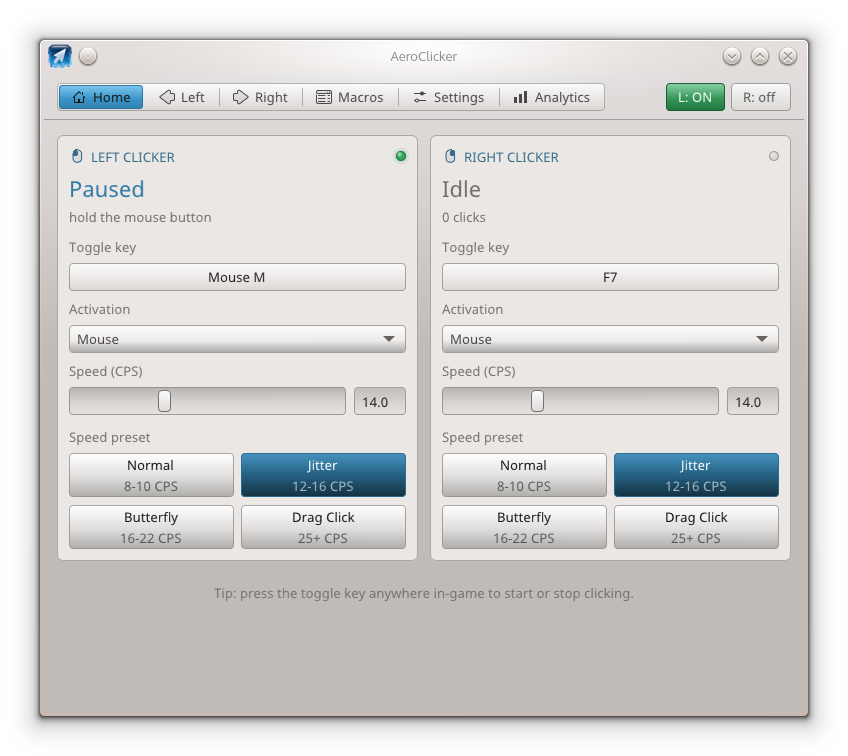
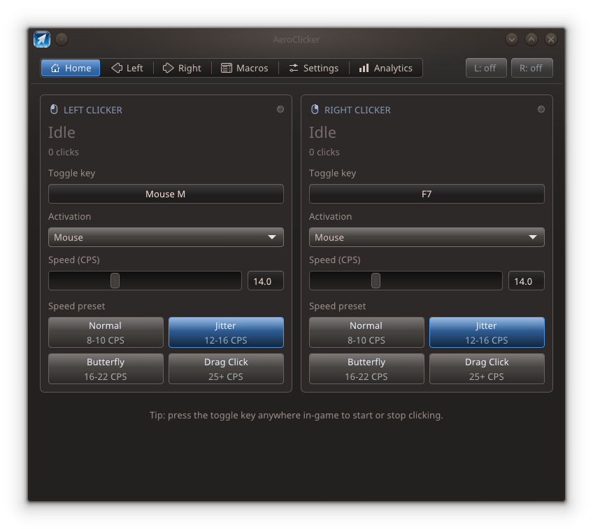

<p align="center">
  
</p>

<h1 align="center">AeroClicker</h1>

<p align="center">
  A humanized auto-clicker for Linux with a custom Oxygen/KDE-inspired interface.
</p>

<p align="center">
  
  
</p>

---

AeroClicker is a standalone auto-clicker for Wayland and X11. It injects clicks through
`/dev/uinput` and reads your keyboard and mouse through evdev, so it works with any application.

The interface is custom: gradients, 1 px borders, hover states and themed graphs, following your
KDE colour scheme in light or dark.

AeroClicker is a fork of [Aubergine-UX's Ghast Clicker](https://github.com/Aubergine-UX/Ghast-Clicker);
its click-timing model comes from [IcySnex/GhostTap](https://github.com/IcySnex/GhostTap).
See [Credits](#credits).

---

## Contents

[Features](#features) · [Requirements](#requirements) · [Install](#install) ·
[Usage](#usage) · [Minecraft mod](#minecraft-mod) · [Interface](#interface) ·
[Files](#files) · [Troubleshooting](#troubleshooting) · [Credits](#credits)

---

## Features

**Clicking**
- **Two independent clickers** — separate left/right speed, humanization, activation mode and keybind
- **Humanization** — Gaussian or uniform timing, spikes, stutters, heavy holds, grip drift, rhythm
  variation and fatigue breaks
- **Presets** — Normal, Jitter (the default), Fast (14-20 CPS) and Butterfly
- **Double-clicks** — optional and randomized; they add a click inside the current beat instead of
  lowering the average rate

**Control**
- **Activation modes** — Toggle, Hold, and Mouse (arm with a key, then hold your real mouse button)
- **Hotbar slots** — optional: a Minecraft hotbar slot switches each clicker on and off, with a
  per-clicker mapping (default: slot 1 left, slot 9 right)
- **Menu pause** — clicking stops while the game has a screen open (inventory, chat, chests)
- **Only click inside the Minecraft window** — optional: clicking stops while another window has focus
- **Left gate** — the left clicker can require a mob, player or fireball in the crosshair and/or a
  sword in hand, so it does not fire while you mine or build
- **Right gate** — the right clicker can require a placeable block, skip beds, require a block in
  the crosshair and pause on chests, doors and other interactive blocks
- **Jump reset** — optional: presses Space shortly after an entity hurts you; environmental damage
  and backstabs are ignored
- **Sprint reset** — optional: taps W, S or Shift after your hit on a living entity to reset sprint
- **Macros** — optional sequences of clicks, delays and slot switches, with looping and a keybind
- **Headless mode** — run the clicker without a window

**Interface**
- **Paused readout** — a switched-on clicker that is held back shows `Paused` and the reason
- **Live analytics** — CPS graphs, session averages and peaks, reset counts, recording and CSV export
- **Profiles** — save and load complete configurations; the `config` profile loads at startup
- **Theming** — follows the KDE colour scheme; the accent can also be fixed or custom
- **Sound feedback** — a short chime when a module toggles, via `paplay`

### Humanization

The Jitter preset is tuned to look human without giving up rate: rare double-clicks, short and
infrequent fatigue breaks, and hold times that drift slowly around their mean like a real hand.
**Normal**, **Fast** and **Butterfly** stay close to that character while changing the speed.
Every value is editable in the **Advanced** tab.

---

## Requirements

- Linux with write access to `/dev/uinput` and read access to `/dev/input/*`
- C++17 compiler, CMake 3.16+
- GLFW 3 and OpenGL 3
- Optional: `paplay` (PipeWire/PulseAudio) for toggle sounds

---

## Install

### Dependencies

```bash
# Arch
sudo pacman -S --needed base-devel cmake glfw

# Debian / Ubuntu
sudo apt install build-essential cmake libglfw3-dev libgl1-mesa-dev

# Fedora
sudo dnf install gcc-c++ cmake glfw-devel mesa-libGL-devel

# Void Linux
sudo xbps-install -S base-devel cmake glfw-devel MesaLib-devel
```

### Build and install

```bash
cmake -S . -B build -DCMAKE_BUILD_TYPE=Release
cmake --build build -j"$(nproc)"
cmake --install build --prefix "$HOME/.local"
```

That installs the binary, a desktop entry and the icons. Settings are not part of the install;
they live in `~/.config/aeroclicker/`.

### Permissions

AeroClicker needs write access to `/dev/uinput` and read access to your input devices. The
`input` group grants both:

```bash
sudo usermod -aG input "$USER"
```

Log out and back in, then run `aeroclicker`. Do **not** run it as root.

### Fix virtual-mouse sensitivity

Some desktops apply a different acceleration curve to the virtual mouse. The included udev rule
gives it a flat profile:

```bash
sudo cp 99-aeroclicker.rules /etc/udev/rules.d/
sudo udevadm control --reload-rules
```

Reconnect the device (or restart AeroClicker) for it to apply.

---

## Usage

```bash
aeroclicker [options]
```

| Option | Description |
| --- | --- |
| `--lcps <n>` / `--rcps <n>` | Left / right CPS mean |
| `--lkey <code>` / `--rkey <code>` | Left / right toggle key as an evdev code |
| `--jkey <code>` / `--skey <code>` | Jump / sprint reset toggle key |
| `--toggle` / `--hold` / `--mouse` | Activation mode for both clickers |
| `--headless` | Run without the GUI |
| `--save` | Save the configuration and exit |
| `-h`, `--help` | Show help |

Options override the saved `config` profile for that run only. The GUI can record keys and mouse
buttons interactively.

### Activation modes

| Mode | Behaviour |
| --- | --- |
| **Toggle** | Press the key to start, press again to stop |
| **Hold** | Clicks while the key is held |
| **Mouse** | Press the key to arm, then hold your real mouse button to auto-click |

### What "Paused" means

A clicker can be on and still be held back. Its card then shows `Paused`, the reason, and an amber
dot:

| Reason | When |
| --- | --- |
| `cursor over app` | the pointer is over AeroClicker's own window |
| `menu is open` | the game reports an open screen |
| `Minecraft is not focused` | **Only click inside the Minecraft window** is on and another window has focus |
| `held item is not a block` | the right gate is on and the held item cannot be placed |
| `holding a bed` | the right gate and **Skip beds while one is held** are on and the held item is a bed |
| `crosshair is not on a block` | the right clicker requires a block in the crosshair |
| `block is interactive` | the crosshair is on a chest, door, trapdoor, bed or similar |
| `no target in crosshair` | the left gate is on and no mob, player or fireball is in the crosshair |
| `no sword in hand` | the left gate is on and the held item is not a sword |

The on/off state is kept, so closing a menu resumes clicking on its own.

---

## Minecraft mod

AeroClicker only sees keyboard and mouse events. The companion Fabric mod in `tools/mc-bridge`
publishes what the game knows — the selected hotbar slot, open screens, the held item, the
crosshair target or block, water/ground state, and hurt or hit events. The mod is read-only: it
never sends input or talks to the server.

Without it, the game-aware options stay inert; plain clicking still works.

### Installing the mod

The prebuilt jar is `tools/mc-bridge/aeroclicker-bridge-1.0.0.jar`.

- Put it in the `mods` folder of the Minecraft instance you use.
- It needs Fabric Loader and Java 21; Fabric API is not required.
- It supports Minecraft 26.1.2, 26.2 and 26.3. Forge and NeoForge cannot load it.
- Restart Minecraft after adding or updating it.

When the link is live, Mod → Global shows `Bridge mod: live`. If the game stops updating the
state, AeroClicker treats it as closed after a few seconds.

### What the mod enables

- **Hotbar activation** — when **Switch clickers with the selected hotbar slot** is on, picking
  a mapped slot switches its clicker on; any other slot switches it off. Opening a menu leaves it
  on but paused.
- **Menu pause, focus check and both gates** — these read the game state instead of guessing keys.
- **Jump reset** — presses Space after an entity hurts you. Fall, fire, lava and other
  environmental damage, backstabs, water and mid-air hits are skipped. The **Reaction preset**
  tiles set the feel in one click: **Legit**, **Balanced** (the default), **Fast** and **Blatant**.
  Presets only change the reaction timing; the movement and water/ground filters keep their own
  settings.
- **Sprint reset** — taps **W**, **S** or **Shift** after your hit on a mob or player so the next
  hit deals full sprint knockback. W-Tap needs a moment with no keys held before it can take the
  keyboard over; the panel says so. W-Tap skips hits made in mid-air.

The left gate's **Click when** choices are **Always**, **Holding a sword**, **Target in crosshair**
(the default) and **Sword + target**. Armor stands are ignored, so holograms and chest timers do
not start the clicker. Fireballs count by default and can be turned off.

The right gate uses **Only right-click while holding a placeable block**, **Skip beds while one
is held**, **Only right-click while looking at a block** and **Pause on interactive blocks**, all
on by default. Holding sneak places a block on a chest or door instead of opening it. A physical
press is only taken over when the clicker would actually act.

Both resets use their own toggle key (F9 and F10 by default), can share one key, and are off by
default. They are randomized but not undetectable — they are behaviour filters, not an anti-cheat
guarantee. Use the gates to make the clicker behave the way you want, and follow the rules of the
servers you play on.

---

## Interface

| Tab | What it does |
| --- | --- |
| **Home** | Both clickers at a glance: live CPS, click counts, on/off switches, presets, reset cards and hotbar readout |
| **Mod** | Bridge status, menu/focus/hotbar settings, both clicker gates, and the jump/sprint resets |
| **Settings** | Audio, profiles and accent |
| **Advanced** | Speed, distribution, humanization, hold timing, spikes, breaks, hotkeys and activation |
| **Macros** | Build macro sequences and bind them to a key |
| **Analytics** | CPS graphs, session statistics, reset counts, recording and CSV export |

---

## Files

```text
~/.config/aeroclicker/
├── config                 # last used profile, loaded at startup
├── <profile-name>         # additional saved profiles
└── analytics_*.csv        # exports from the Analytics tab
```

If `~/.config/ghast-clicker/` exists and `aeroclicker/` does not, the old directory is copied on
first start so profiles and keybinds survive the rename.

---

## Troubleshooting

**Clicks do not happen**
- Add yourself to the `input` group and log back in; check that `/dev/uinput` is writable.
- Mouse mode only clicks while your real button is held after arming.
- A switched-on clicker showing `Paused` is being held back — the card names the reason.

**The mod-dependent features do nothing**
- Install the bridge jar, restart Minecraft, and check that Mod → Global says `Bridge mod: live`.
- Slot activation, the menu pause, both gates and the resets do nothing without it.

**A clicker switched itself off**
- A mouse button bound as a toggle is also a game button (middle click is pick block).
  Bind toggles to keys the game does not use; the defaults are F6–F10.

**Jump or sprint reset does nothing**
- Both need a live bridge link and the current jar.
- Jump reset needs you moving with WASD, on the ground and out of water by default.
- W-Tap needs W held and the panel to say **W-Tap is active**; release every key once after
  enabling it so the app can take the keyboard over.

**No toggle sounds**
- Install `paplay`. Sound is optional and silently skipped when unavailable.

**Wrong colours or blurry HiDPI**
- Colours come from `~/.config/kdeglobals`, with an accent override in Settings. Restart after
  changing the display scale if the UI still looks off.

---

## Credits

- **[Aubergine-UX](https://github.com/Aubergine-UX)** — created the original
  [Ghast Clicker](https://github.com/Aubergine-UX/Ghast-Clicker) Linux/Wayland project this fork is
  based on. AeroClicker keeps its clicker engine and the evdev/uinput input layer.
- **[IcySnex](https://github.com/IcySnex)** — [GhostTap](https://github.com/IcySnex/GhostTap), the
  humanization engine and variance model the click timing is based on.
- **[b1scoito](https://github.com/b1scoito)** / Rafael Félix — [b1scoito/clicker](https://github.com/b1scoito/clicker),
  the earlier Windows clicker the project line descends from.
- **[ocornut](https://github.com/ocornut)** and contributors — [Dear ImGui](https://github.com/ocornut/imgui),
  bundled as version 1.93.0.
- **[GLFW](https://www.glfw.org/)** — windowing and input for the GUI.

This fork adds the AeroClicker rename, the Oxygen/KDE-inspired interface, the
Home/Settings/Macros/Analytics tabs, the Minecraft bridge and gates, and the Jump reset and
Sprint reset modules, plus assorted fixes.

---

## License

AeroClicker is licensed under the **GNU General Public License v3.0** — see
[LICENSE](LICENSE). As a fork of GPL-3.0 software, it stays under the same license.
