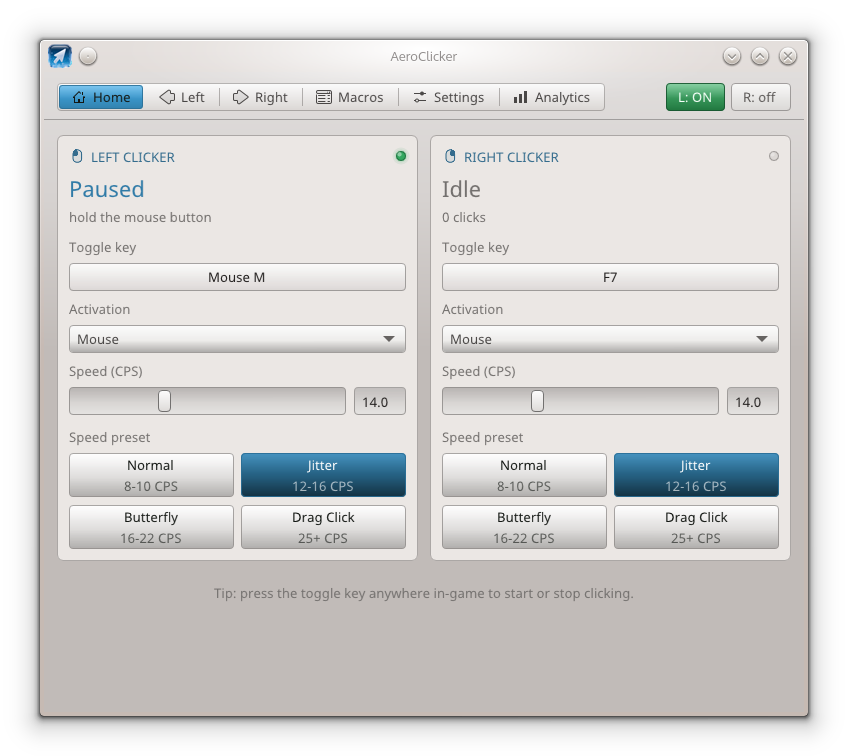
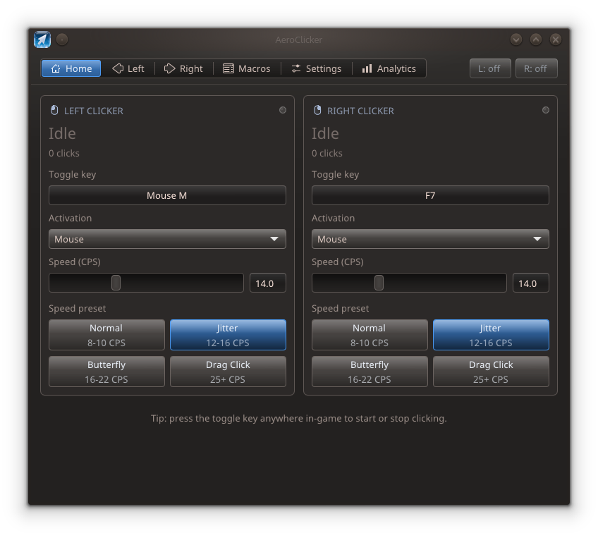

<p align="center">
  
</p>

<h1 align="center">AeroClicker</h1>

<p align="center">
  A humanized auto-clicker for Linux with a custom Oxygen/KDE-inspired interface.
</p>

<p align="center">
  
  
</p>

---

AeroClicker is a standalone auto-clicker for Wayland and X11. It injects clicks through
`/dev/uinput` and reads your keyboard and mouse through evdev, so it works with any application
and never touches the applications themselves.

The interface is custom: it borrows the Oxygen/KDE look — gradients, 1 px borders, hover states
and themed graphs — and follows your KDE colour scheme, light or dark.

AeroClicker is a fork of [Aubergine-UX's Ghast Clicker](https://github.com/Aubergine-UX/Ghast-Clicker),
which in turn ports the humanization engine from [IcySnex/GhostTap](https://github.com/IcySnex/GhostTap).
See [Credits](#credits).

---

## Contents

[Features](#features) · [Requirements](#requirements) · [Install](#install) ·
[Usage](#usage) · [Minecraft mod](#minecraft-mod) · [Interface](#interface) ·
[Files](#files) · [Troubleshooting](#troubleshooting) · [Credits](#credits)

---

## Features

**Clicking**
- **Two independent clickers** — separate left/right CPS, humanization, activation mode and keybind
- **Humanization** — Gaussian and uniform timing, spikes and stutters, heavy holds, grip drift, rhythm volatility and tension, a start delay in Mouse mode, and fatigue breaks
- **Presets** — Normal, Jitter (the default), Butterfly and Drag Click, ready to tweak
- **Double-clicks** — optional, with a randomized delay; they land inside the current beat, so they never lower the average CPS

**Control**
- **Activation modes** — Toggle, Hold, and Mouse (arm with a key, then hold your real mouse button)
- **Slot activation** — a Minecraft hotbar slot switches each clicker on and off, with a per-clicker set of slots (default: slot 1 left, slot 9 right); it reads the game through the [bridge mod](#minecraft-mod)
- **Menu pause** — clicking stops while the game has a screen open (inventory, chat, chests, NPC menus) and resumes when it closes
- **Left gate** — the left clicker can require a player in the crosshair, a sword in hand, or both, so it does not fire while you mine or build; the default is player-in-crosshair
- **Right gate** — the right clicker can require a placeable block in hand, so right-click actions never fire on a sword, a pearl or an empty hand
- **Macros** — optional, off by default: sequences of left clicks, right clicks, delays and slot switches, with looping and a keybind
- **Headless mode** — run the clicker with no window

**Interface**
- **Paused readout** — a switched-on clicker that is held back shows `Paused` and the reason, with an amber dot, instead of a misleading green `ON`
- **Live analytics** — real-time CPS graphs, session averages and peaks, optional recording and CSV export
- **Profiles** — save and load complete configurations; the `config` profile loads at startup
- **Theming** — follows the KDE colour scheme and accent; the accent can also be fixed to Blue, Red, Green, Purple or Orange, or a custom colour
- **Sound feedback** — a short two-note chime when a clicker toggles, via `paplay`

### Humanization defaults

The Jitter preset is tuned to look human without giving up rate. Double-clicks are rare — 1 % of
beats — and always land inside the current one, so they add clicks instead of lengthening the gap.
Fatigue breaks are short and infrequent: 0.15–0.4 s of rest every 40–90 s, and the break clock
restarts whenever clicking is paused, so resuming never begins with a break. Hold times follow the
rate and drift slowly around their mean, as a real hand's grip does, rather than being independent
random draws. Every value is editable on the **Left**/**Right** tabs, and **Normal**, **Butterfly**
and **Drag Click** raise the double-click chance as the click rate rises.

---

## Requirements

- Linux with write access to `/dev/uinput` and read access to `/dev/input/*` — see [Install](#install)
- C++17 compiler, CMake 3.16+
- GLFW 3 and OpenGL 3
- Optional: `paplay` (PipeWire/PulseAudio) for toggle sounds

Dear ImGui 1.93.0 is vendored in `imgui-1.93.0/`, so no extra downloads are needed.

---

## Install

### Dependencies

```bash
# Arch
sudo pacman -S --needed base-devel cmake glfw

# Debian / Ubuntu
sudo apt install build-essential cmake libglfw3-dev libgl1-mesa-dev

# Fedora
sudo dnf install gcc-c++ cmake glfw-devel mesa-libGL-devel

# Void Linux
sudo xbps-install -S base-devel cmake glfw-devel MesaLib-devel
# optional, for toggle sounds: sudo xbps-install -S pulseaudio-utils   (paplay)
```

### Build and install

```bash
cmake -S . -B build -DCMAKE_BUILD_TYPE=Release
cmake --build build -j"$(nproc)"
cmake --install build --prefix "$HOME/.local"   # per user, or without --prefix for /usr/local
```

The binary is also left at `build/aeroclicker` if you would rather not install it.

`cmake --install` writes three things under the prefix and touches nothing else:

| Path under the prefix | What it is |
| --- | --- |
| `bin/aeroclicker` | the binary |
| `share/applications/aeroclicker.desktop` | menu entry with the absolute binary path and the icon name |
| `share/icons/hicolor/*/apps/aeroclicker.png` | the app icon, one file per theme size |

Your settings are not part of the install: they live in `~/.config/aeroclicker/` and are created
on the first save. The udev rule below is not installed either — copy it yourself if you need it.
`build/install_manifest.txt` lists what was written, so `xargs rm -v < build/install_manifest.txt`
removes an install again.

### Permissions

AeroClicker needs write access to `/dev/uinput` and read access to your input devices. The
`input` group is the supported way to get both:

```bash
sudo usermod -aG input "$USER"
```

Log out and back in (a new terminal is not enough; the group list is read at login), then run
`aeroclicker` normally. If access is still missing, startup stops with `Cannot open /dev/uinput`
and the command to fix it.

**Do not run it as root.** `sudo` is not needed for anything the app does, and it gives a program
that synthesizes input full system privileges, a root-owned window in your session, and root's
environment instead of yours. The app tolerates `sudo`, but fix the group membership instead.

### Fix virtual-mouse sensitivity

Some desktops apply a different pointer acceleration curve to the virtual mouse. The included
udev rule gives it the same flat profile as a normal mouse:

```bash
sudo cp 99-aeroclicker.rules /etc/udev/rules.d/
sudo udevadm control --reload-rules
```

Reconnect the device (or restart AeroClicker) for the rule to apply.

---

## Usage

```bash
aeroclicker [options]
```

| Option | Description |
| --- | --- |
| `--lcps <n>` | Left CPS mean (default `13.0`) |
| `--rcps <n>` | Right CPS mean (default `15.0`) |
| `--lkey <code>` | Left hotkey as an evdev code (default `F6`) |
| `--rkey <code>` | Right hotkey (default `F7`) |
| `--toggle` | Toggle activation for both clickers |
| `--hold` | Hold activation for both clickers |
| `--mouse` | Mouse activation for both clickers (default) |
| `--headless` | Run without the GUI |
| `--save` | Save the configuration and exit |
| `-h`, `--help` | Show help |

Options apply on top of the saved `config` profile, for that run only. Key codes are evdev codes
(see `/usr/include/linux/input-event-codes.h`), not X11 keysyms; the GUI can also record keys
and mouse buttons interactively.

### Activation modes

| Mode | Behaviour |
| --- | --- |
| **Toggle** | Press the key to start, press again to stop |
| **Hold** | Clicks while the key is held |
| **Mouse** | Press the key to arm, then hold your real mouse button to auto-click; the real press is masked instead of reaching the application |

In Mouse mode AeroClicker takes exclusive access to the physical mouse so it can forward each
event exactly once. Other modes only read input passively, and a hotkey bound to a mouse button
works in every mode. Devices are picked up when they appear, so replugging does not need a
restart.

### What “Paused” means

A clicker can be switched on and still be held back. Its card then shows `Paused`, the reason,
and an amber dot instead of a running CPS figure:

| Reason | When |
| --- | --- |
| `cursor over app` | the pointer is over AeroClicker's own window |
| `menu is open` | the game reports an open screen |
| `held item is not a block` | **Right gate** is on and the held item cannot be placed |
| `no player in crosshair` | the left gate is set to player-in-crosshair (or sword + player) and you are not looking at a player |
| `no sword in hand` | the left gate is set to sword-only (or sword + player) and the held item is not a sword |

The on/off state is kept, so closing the menu resumes clicking on its own. To force it, press the
clicker's hotkey (or its **L/R** pill): an explicit press un-pauses a paused clicker instead of
switching it off and lifts the menu pause until a menu opens again.

---

## Minecraft mod

AeroClicker only sees keyboard and mouse events, which is not enough in Minecraft: the active
hotbar slot can move without a key you can see, an open menu looks like a normal world, and the
held item and the crosshair are invisible from outside. The companion mod in `tools/mc-bridge`
publishes those facts, and the app uses them for slot activation, the menu pause and both gates.

Nothing falls back to key guessing: without the mod, slot activation and the menu pause do
nothing, and both gates stay inert.

The mod is read-only. Every 50 ms it writes the selected slot, whether a screen is open, whether
the held item is a block, whether it is a sword and whether the crosshair is on another player to
`$XDG_RUNTIME_DIR/aeroclicker-mc.state` as a single line:

```
slot=<0-8, or -1 outside a world> screen=<0|1> ms=<epoch ms> block=<0|1|-1> sword=<0|1|-1> player=<0|1|-1>
```

`block`, `sword` and `player` are `1` for yes, `0` for no and `-1` for "this mod build cannot
tell". Nothing is sent to the server and no input is changed. When the file stops updating (the
game closed or crashed), the app treats the game as gone after 2.5 seconds: slot activation stops
and any clicker it switched on is switched off.

### Installing the mod (optional)

Skip this if you do not want slot activation, the menu pause or either gate. Nothing is installed
automatically: AeroClicker does not copy the jar anywhere, and `cmake --install` does not touch
your Minecraft folders. Put the jar in the `mods` folder of the instance you use, like any other
Fabric mod:

- The file is `tools/mc-bridge/aeroclicker-bridge-1.0.0.jar`.
- Create the `mods` folder if it does not exist yet.
- It needs Fabric Loader and Java 21; Fabric API is not required.
- It covers Minecraft 26.1.2, 26.2 and 26.3. Forge and NeoForge cannot load it.
- Restart Minecraft after adding or updating it.

Settings → Minecraft shows `Bridge mod: live` while the game is publishing state, and highlights
the slot the game currently has selected. A prebuilt jar ships in the repository, so installing
needs no toolchain. After changing the mod's source, rebuild it with
`./tools/mc-bridge/build.sh` (a JDK 21+ with `javac` and `jar`); the script finds the Fabric
loader jar in the usual Prism location, and elsewhere it can be passed with
`FABRIC_LOADER=/path/to/fabric-loader-*.jar`.

With the link live, slot activation applies as soon as the slot changes: picking a slot listed
under a clicker switches that clicker on, any other slot switches it off, and opening a menu
leaves it on but paused. A key or pill press still works normally and holds until the next slot
change. On the Home page the nine chips show the mapping: the accent fills the side that owns the
slot (left edge for the left clicker, right edge for the right clicker), while a slot both
clickers map is accent across its full width.

### Left gate (GhostTap-style)

Settings → Minecraft has **Left gate** with four choices:

| Value | Behaviour |
| --- | --- |
| **Off** | no game check |
| **Sword only** | clicks only while a sword is held |
| **Player in crosshair** | clicks only while another player is in the crosshair (the default) |
| **Sword + player** | both of the above |

Player-in-crosshair is the closest to GhostTap's behaviour. It also fixes the obvious problem
with a plain left clicker in Minecraft: while you mine a block the crosshair is on the block, not
on a player, so the gate pauses the clicker and your physical left press reaches the game
untouched. Mining, breaking and building work normally, and the clicker resumes as soon as you
look at a player. A physical press is only taken over when the clicker would actually act on it.

Sword-only is a simpler check for servers where the sword is the signal that a fight is starting.
It does not stop mining by itself: a sword is still a sword while you dig. Use
player-in-crosshair or sword + player if mining must never produce synthetic clicks.

A `sword` or `player` field the running mod does not report leaves that half of the gate inert,
and the Settings panel says so instead of silently blocking every click.

### Right gate

Settings → Minecraft has **Right gate** for the right clicker. With it on, the right clicker only
clicks while the held item is a block that can be placed, and pauses with the reason
`held item is not a block` for anything else — a sword, a bucket, food, an empty hand. It is the
right-click equivalent of only bridging when you actually hold blocks, so a right click never
throws a pearl, starts drinking a potion or wears down a tool by accident.

The gate is driven by the same mod, so it needs a live link and a mod build that reports the held
item. Without either it stays inert instead of blocking every right click. A physical right press
is only taken over when the clicker would actually act on it; while the gate is blocking, the
press and its release go to the game untouched.

### Are the gates an anti-cheat feature?

No. They are behaviour filters, not a guarantee of being undetected. Player-in-crosshair makes a
clicker look more like a person fighting — it stops firing at blocks and stops firing at nothing —
but a server can still measure click timing, and the humanization is what actually shapes that.
The right gate is mostly a usability filter: it prevents accidental pearls, water and potions,
and it does little for detection because right clicks are rarely what an anti-cheat flags. Use
the gates to make the clicker behave the way you want; do not treat them as a way to evade a
server's rules.

---

## Interface

| Tab | What it does |
| --- | --- |
| **Home** | Both clickers at a glance, with live CPS, click counts, on/off pills and the slot activation readout |
| **Settings** | A mod-only **Minecraft** panel (link status, slot activation, menu pause, both gates) above a divider, then audio, profiles and accent — everything below the divider works without the mod |
| **Left / Right** | Presets, speed, distribution, humanization, hold timing, spikes, breaks, hotkey and activation mode |
| **Macros** | Build macro sequences and bind them to a key |
| **Analytics** | Measured CPS graphs, session statistics, recording and CSV export |

---

## Files

Everything lives in `~/.config/aeroclicker/`:

```
~/.config/aeroclicker/
├── config                 # last used profile, loaded at startup
├── <profile-name>         # additional saved profiles
├── analytics_left_*.csv   # exports from the Analytics tab
└── analytics_right_*.csv
```

On first start, if `~/.config/aeroclicker/` does not exist but the old
`~/.config/ghast-clicker/` does, AeroClicker copies the old directory over so your profiles and
keybinds survive the rename.

---

## Troubleshooting

**Clicks do not happen**
- Make sure you can open `/dev/uinput` (add yourself to the `input` group, then re-login).
- Check that `/dev/input/event*` is readable — `groups` should list `input`.
- In Mouse mode the clicker only clicks while your real button is held after arming.
- A switched-on clicker showing `Paused` is being held back — see
  [What “Paused” means](#what-paused-means).

**Slot activation does nothing in Minecraft**
- It needs the bridge mod; without it the app does not guess. Install it as described in
  [Minecraft mod](#minecraft-mod), then restart Minecraft.

**The right clicker stops with `held item is not a block`**
- That is the **Right gate**: the held item cannot be placed. Hold a block, or switch
  **Right gate** off. This also appears if the mod is an older build that does not export the
  held item; update the jar and restart Minecraft.

**The left clicker stops with `no player in crosshair`**
- The left gate is on its default and you are not looking at another player. Look at a player,
  or change **Left gate** in Settings → Minecraft.

**No toggle sounds**
- Install `paplay` (PipeWire/PulseAudio). Sound is optional and silently skipped when unavailable.

**Wrong colours**
- AeroClicker reads the colour scheme from `~/.config/kdeglobals` and falls back to its own
  palette. Change the system scheme, or pick an accent in Settings.

**Blurry or oversized on a HiDPI screen**
- The UI follows the compositor's scale factor and rebuilds its font atlas when it changes.
  Restart AeroClicker if it still looks off after changing scale or moving monitors.

---

## Development

A normal build and install need only a compiler, CMake, GLFW and OpenGL. Nothing in `tools/` is
needed to build the app: the generated app icons and the 16 px symbolic masks are committed, so
no Python or icon tooling is required. `tools/mc-bridge/` holds the Fabric mod source, its
`build.sh` and the prebuilt jar; keep it only if you want to offer the Minecraft mod.

---

## Credits

- **[Aubergine-UX](https://github.com/Aubergine-UX)** — created the original
  [Ghast Clicker](https://github.com/Aubergine-UX/Ghast-Clicker) Linux/Wayland port this project
  is forked from. AeroClicker keeps its architecture, clicker engine and evdev/uinput input layer.
- **[IcySnex](https://github.com/IcySnex)** — [GhostTap](https://github.com/IcySnex/GhostTap),
  the humanization engine and variance model the click timing is based on.
- **[b1scoito](https://github.com/b1scoito)** / Rafael Félix — [b1scoito/clicker](https://github.com/b1scoito/clicker),
  the original Windows clicker whose code and ideas the project descends from.
- **[ocornut](https://github.com/ocornut)** and contributors — [Dear ImGui](https://github.com/ocornut/imgui),
  bundled here as version 1.93.0.
- **[GLFW](https://www.glfw.org/)** — windowing and input for the GUI.

Changes in this fork include the rename to AeroClicker, the Dear ImGui 1.93.0 upgrade, the custom
Oxygen/KDE-inspired interface, new Home/Settings/Macros/Analytics tabs, the pause/hotkey
behaviour, the Minecraft bridge and gates, and assorted fixes. Thanks to everyone whose commits
appear in the history.

---

## License

AeroClicker is licensed under the **GNU General Public License v3.0** — see
[LICENSE](LICENSE). As a fork of GPL-3.0 software, it stays under the same license.
